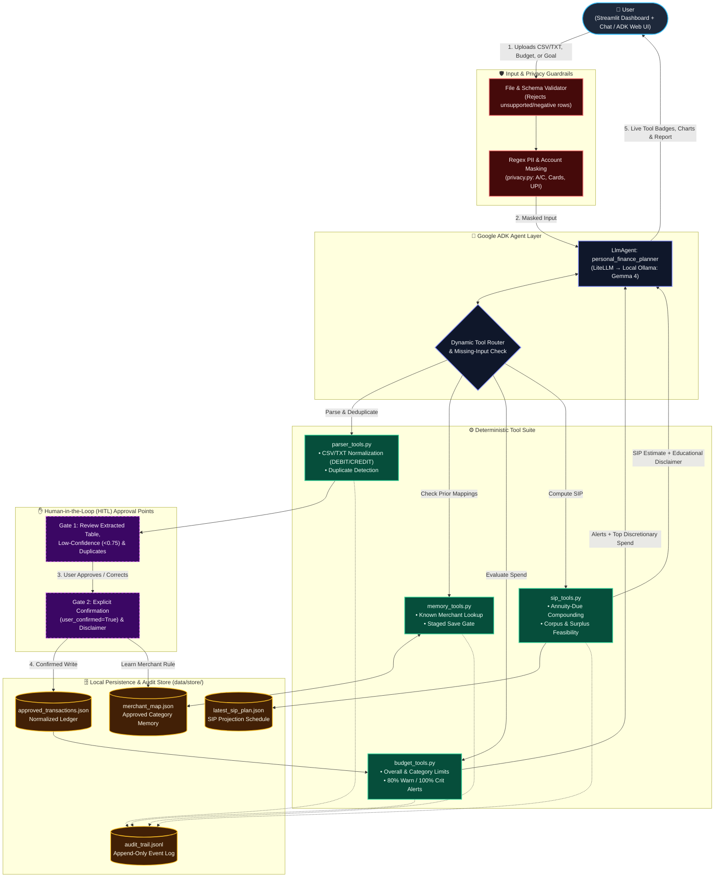

# Personal Finance & Goal-Based SIP Planner Agent

A local-first, privacy-preserving agentic personal finance assistant built with **Google ADK (`LlmAgent`)**, **Ollama**, and **Gemma 4**.

It converts synthetic bank statements or receipts into normalized, categorized transactions (`DEBIT` / `CREDIT`), enforces human-in-the-loop review before persisting data, monitors monthly budgets with configurable warning/critical alerts, and generates deterministic goal-based SIP plans with interactive dashboards.

> **Responsible AI Disclaimer:** This application uses synthetic/anonymized data only and provides **educational financial planning support, not regulated financial or investment advice**. Mutual fund investments are subject to market risks; returns are assumed for projection purposes and are not guaranteed.

---

## Key Features

- **Multi-Format Ingestion & Normalization:** Parses bank statement CSVs (`transaction_id,date,merchant,raw_description,amount_inr,direction,currency`) and raw receipt `.txt` files while rejecting unsupported formats and corrupted/negative entries.
- **Privacy & PII Masking Guardrails:** Automatically masks bank account numbers (`XXXX-XXXX-1012`), card numbers, and UPI handles (`r***@okicici`) before data reaches LLM context or audit logs.
- **Confidence Scoring & Human-in-the-Loop (HITL):** Categorizes transactions across 13 standard categories with confidence scores and reasons, flags low-confidence (`< 0.75`) and duplicate rows, and blocks persistence until explicit user approval.
- **Persistent Merchant Memory & Audit Trail:** Remembers user-approved merchant-to-category mappings (`merchant_map.json`) and logs every state-changing action to an append-only audit trail (`audit_trail.jsonl`).
- **Configurable Budget Monitoring:** Tracks overall and category-level spending against configurable thresholds (**Warning ≥ 80%**, **Critical ≥ 100%**) and suggests data-grounded reductions from top discretionary categories.
- **Deterministic Goal-Based SIP Calculator:** Computes required monthly SIP installments using exact annuity-due compounding (accounting for existing corpus, horizon, risk profile, and monthly investible surplus) — never relying on LLM arithmetic.
- **Dual UI Architecture:** Includes a **Streamlit Chat + Live Dashboard (`app.py`)** showing real-time tool calls, budget charts, and SIP growth curves, alongside full compatibility with **Google ADK's built-in Web UI (`adk web`)**.

---

## Architecture



---

## Repository Structure

```text
personal-finance-planner-agent/
├── README.md                          # Project documentation, setup, and architecture
├── TEST_EVIDENCE.md                   # Unit test logs, rubric test matrix, and walkthrough evidence
├── requirements.txt                   # Compatible Python dependencies
├── pytest.ini                         # Pytest path configuration
├── .env.example                       # Configurable Ollama model and budget alert thresholds
├── .gitignore                         # Ignores local runtime state, uploads, and .venv
├── app.py                             # Primary Streamlit UI (Chat + Live Budget & SIP Dashboards)
├── data/
│   ├── sample/                        # Synthetic test inputs (with duplicates, OCR/ambiguous cases)
│   │   ├── synthetic_statement.csv
│   │   └── sample_receipt.txt
│   └── store/                         # Runtime persistence (JSON ledger, merchant map, audit log)
├── finance_planner/                   # Google ADK Agent Package
│   ├── __init__.py
│   ├── agent.py                       # Root LlmAgent definition & workflow instructions
│   ├── config.py                      # Central environment settings & standard categories
│   ├── schemas.py                     # Pydantic schemas for normalized transactions
│   ├── tools/
│   │   ├── __init__.py
│   │   ├── parser_tools.py            # CSV/TXT parser, schema validator, and duplicate detector
│   │   ├── memory_tools.py            # Human-in-the-loop staging, merchant memory, and audit logger
│   │   ├── budget_tools.py            # Deterministic budget evaluator & 80%/100% alert engine
│   │   └── sip_tools.py               # Deterministic goal-based SIP compounding calculator
│   └── utils/
│       ├── __init__.py
│       └── privacy.py                 # Regex account, card, and UPI masking utilities
└── tests/
    └── test_deterministic_tools.py    # Automated unit tests for all deterministic modules
```

---

## Prerequisites & Setup

### 1. Install Ollama & Pull Gemma 4
Download [Ollama](https://ollama.com) and pull a Gemma 4 model:
```bash
# Recommended for 8GB–16GB RAM laptops
ollama pull gemma4:e4b

# Optional for 24GB+ RAM / 16GB+ VRAM workstations
ollama pull gemma4:26b
```

### 2. Clone & Configure the Python Environment
```bash
git clone <your-repo-url>
cd personal-finance-planner-agent

python -m venv .venv
source .venv/bin/activate        # Windows PowerShell: .venv\Scripts\Activate.ps1

pip install -r requirements.txt
cp .env.example .env             # Windows: copy .env.example .env
```

### 3. Run Automated Unit Tests
```bash
pytest -v
```

---

## Running the Application

### Option A: Streamlit Chat + Live Dashboard (Primary UI)
Displays real-time tool invocations alongside live budget utilization metrics, category spend charts, and goal SIP compounding curves:
```bash
streamlit run app.py
```

### Option B: Google ADK Built-in Web UI (Fallback / Developer UI)
```bash
adk web
```
Open `http://127.0.0.1:8000` in your browser and select **`finance_planner`** from the top-left agent dropdown.

---

## Sample Demo Walkthrough Prompts

1. **Ingest & Review (Triggers PII Masking, Deduplication & Human Approval Gate):**
   > *"Parse `data/sample/synthetic_statement.csv`, categorize the transactions, and show them to me for review before saving."*
2. **Approve & Teach Merchant Memory:**
   > *"I approve saving the valid non-duplicate transactions. Map ABC Enterprises to Shopping and save them."*
3. **Budget Alert & Goal-Based SIP Plan:**
   > *"Check my monthly budget of ₹40,000, and calculate a goal-based SIP plan to build ₹25,00,000 in 7 years with ₹2,00,000 existing corpus, moderate risk profile, and ₹22,000 monthly investible surplus."*

---

## Supported Inputs & Configuration

- **Supported Formats:** `.csv` (with headers `transaction_id,date,merchant,raw_description,amount_inr,direction,currency`) and `.txt` receipt files.
- **Configurable Environment Variables (`.env`):**
  - `OLLAMA_MODEL` (default: `ollama_chat/gemma4:e4b`)
